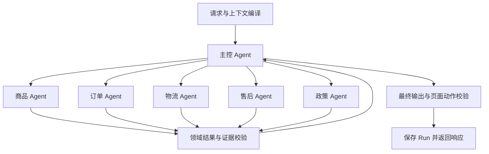

# 电商智能客服多智能体改造规划与实现记录

日期：2026-10-22

2026-10-24最新更新：积分专家由六个查询工具合并为 `get_points_account`、`get_points_transactions`、`check_points_eligibility`、`get_order_points` 四个；积分订单及前端展示使用真实积分字段，旧演示现金订单已按明确演示积分价迁移。admin增加逐次模型耗时和Token明细。下文原始设计和历史口径保留，当前接口以[积分客服接入说明](积分客服接入说明.md)为准。

状态：首版主控加五个领域专家已完成；2026-10-24 按新增范围接入积分专家，当前为一个主控加六个领域专家。原始设计与首版记录保留在下文，积分接口约定见[积分客服接入说明](积分客服接入说明.md)。

2026-10-24 后续清理：旧单智能体领域切换工具 `load_skill`、`SkillScopeMiddleware`、`active_skill_code` 及相关路由提示词已删除。六个领域配置继续用于构建专家，当前七个系统提示词保持一致。下文涉及原动态加载流程的内容属于历史设计说明。

## 1. 改造目标与范围

将当前单 Agent 加动态 Skill 架构，改为一个主控 Agent 加五个独立领域子 Agent。主控理解用户目标、拆解任务并汇总结果，领域 Agent 在独立消息轨迹中调用自己的工具。

首版范围：

- 商品、订单、物流、售后、政策五个领域。
- 串行委派，支持一个用户问题涉及多个领域。
- 复用现有只读业务工具、运行记录、结构化输出、事实校验和页面引导。
- 保持现有对外请求及响应结构兼容。
- 增加子任务级证据隔离、Run 级共享预算和部分失败处理。

首版不包含自动退款、密码二次认证、完整 RAG、PDF/OCR、后台异步任务、跨进程恢复和多子 Agent 并行执行。这些属于独立能力，不能由多智能体改造自动获得。

## 2. 当前实现与框架选择

### 2.1 当前项目是什么架构

当前 [factory.py](../atguigu/agent/factory.py) 通过 `langchain.agents.create_agent` 创建一个客服 Agent，配置了：

- `ToolStrategy(AgentOutput)`：结构化输出。
- `support_prompt`：根据状态生成提示词。
- `SkillScopeMiddleware`：根据当前 Skill 筛选模型可见工具。
- `ToolCallLimitMiddleware(run_limit=8, exit_behavior="error")`：工具调用计数保护。

目前没有主控调用独立专家的过程，也没有每个专家自己的消息轨迹。

### 2.2 为什么继续使用 LangChain

| 方案 | 适用场景 | 本次选择 |
| --- | --- | --- |
| LangChain `create_agent` + 子 Agent 委派工具 | 工具调用型客服、多领域专家协作 | 推荐，复用现有实现 |
| 直接使用 LangGraph 编排 | 固定步骤、复杂条件分支、中断恢复、显式状态控制 | 后续业务流程需要时使用 |
| Deep Agents | 需要任务规划、文件操作和复杂委派的开放式长任务 | 当前无需引入 |

LangChain `create_agent` 基于 LangGraph。继续使用 LangChain 并不意味着放弃 LangGraph；也无需为了拥有多个 Agent 而换成 Deep Agents。

替代架构比较：

| 架构 | 优点 | 代价 |
| --- | --- | --- |
| 主控 + 专家 | 主控统一协调，适合跨领域问题 | 增加模型调用与汇总开销 |
| 分类路由 + 专家 | 简单直接，适合单领域请求 | 多领域问题需额外编排 |
| 专家之间相互交接 | 交互灵活 | 控制权、状态与终止条件更复杂 |

本次推荐主控 + 专家。多智能体不保证更快或更准确，验收需要同时关注任务效果、耗时和 Token 成本。

参考：[LangChain Subagents](https://docs.langchain.com/oss/python/langchain/multi-agent/subagents)。

## 3. 六个疑问的代码解释

### 3.1 原本动态提示词在动态切换什么

对应 [dynamic_prompt.py](../atguigu/agent/harness/dynamic_prompt.py)。

实际拼接关系：

```text
完整系统提示词
  = BASE_PROMPT
  + 当前 Skill 的处理指引
  + 页面动作白名单
```

其中主要动态变化的是中间的 Skill 指引：

| 状态 | 注入的内容 |
| --- | --- |
| 没有 `active_skill_code` | 五类 Skill 的精简索引，要求先调用 `load_skill` |
| `order-service` | 如何查订单、何时生成订单页面引导等订单规则 |
| `logistics-service` | 如何查物流、物流结论必须来自哪些工具等规则 |
| 其他 Skill | 对应领域的处理指引 |

`@dynamic_prompt` 在每次模型调用前读取当前状态，所以同一次用户请求内部也能切换指引，不只是两轮用户对话之间切换。

示例：

```text
初始：领域索引提示词
  → 模型调用 load_skill("order-service")
  → Command 更新 active_skill_code
  → 下次模型调用使用订单指引
  → 模型调用 load_skill("logistics-service")
  → 下次模型调用使用物流指引
```

它没有切换模型，没有创建新 Agent，也没有给不同 Skill 创建独立消息上下文。

同时，工具切换由 `SkillScopeMiddleware` 完成。动态提示词告诉模型怎么处理，工具中间件控制当前向模型提供哪些工具，两者分工不同。

### 3.2 为什么 SkillScopeMiddleware 和 active_skill_code 在新链路中不再使用

对应 [skills/middleware.py](../atguigu/agent/harness/skills/middleware.py) 和 [tools/skill.py](../atguigu/agent/harness/tools/skill.py)。

旧架构需要在同一个 Agent 内切换角色：

```text
单 Agent + active_skill_code
  → 动态筛选订单工具或物流工具
```

新架构在创建时就固定专家职责：

```text
订单 Agent → 仅注册订单工具
物流 Agent → 仅注册物流相关工具
```

因此，固定领域专家不需要再加载或切换 Skill。主控只接收委派工具，也不使用业务 Skill 切换状态。

若直接给固定领域专家保留当前中间件，又没有初始化 `active_skill_code`，中间件会只留下 `load_skill`，造成专家原本注册的查询工具不可见。

这里的“退出”是推荐方案中的职责简化，不是框架强制要求，也不意味着删除 Skill 领域配置。领域名称、指引和工具清单继续复用；旧中间件是否保留为兼容代码，在实施时按引用情况决定。

未来某个专家内部拥有多种子能力时，仍可给该专家设计自己的动态 Skill。多智能体与动态 Skill 可以组合，只是首版没有这个必要。

### 3.3 证据引用是什么，是工具结果吗

证据是服务端实际记录的工具调用，包括工具名称、参数、成功状态和返回结果。证据引用是定位这份记录的标识，不是把结果全文重复存一遍。

例子（示意数据，不是数据库真实记录）：

```json
{
  "run_id": "run_demo",
  "tool_call_id": "call_demo",
  "tool_name": "get_logistics",
  "arguments": {"order_id": "ORDER_001"},
  "success": true,
  "result": {"data": {"status": "in_transit"}}
}
```

引用可以由 `run_id + tool_call_id` 定位。校验时再读取真实记录，确认它属于当前子任务、调用成功、订单匹配，并且返回数据支持所述结论。

当前已有 [AgentToolCall](../atguigu/models/models.py) 和 [ToolCallSnapshot](../atguigu/agent/harness/tools/snapshot.py)，但 Snapshot 还没有暴露 `tool_call_id`，也没有完整子任务归属。计划补齐这部分关联。

不能只相信模型返回“我引用了 call_demo”。引用清单由服务端从当前子任务实际调用中绑定，模型文本不得决定自己拥有哪份证据。

首版建议：

1. 子任务创建时生成 `task_id`。
2. 记录工具调用时，由服务端生成任务命名空间下的存储标识。
3. 原模型 `tool_call_id` 仍用于对应 ToolMessage，不改写模型消息协议。
4. 数据库存储标识与模型原标识之间由执行层映射，并确保满足当前字段长度及唯一约束。
5. 子任务结果由服务端附加对应引用，供领域校验和最终校验使用。

不新增数据库字段的首版只提供日志与调用标识关联，不宣称拥有可恢复的持久化子任务状态机。

### 3.4 页面动作是什么，为什么目前只有一个

页面动作是返回给前端的一个操作入口，例如“前往取消订单”“前往修改地址”“申请售后”。它不是已执行退款或已修改订单。

当前链路：

```text
模型输出 PageActionRequest(action_code, resource_id)
  → 服务端检查动作白名单和目标订单证据
  → 按固定模板生成 PageAction(label, description, href)
  → 响应 content.action
  → 前端可据此展示页面入口
```

示例：

```json
{
  "label": "前往修改地址",
  "description": "进入订单页面修改收货地址",
  "href": "/me/orders/ORDER_001/address"
}
```

当前只有一个是因为数据模型和响应协议使用单对象：

- `AgentOutput.page_action_request: PageActionRequest | None`。
- `ValidatedAgentOutput.page_action: PageAction | None`。
- 响应写入 `content.action`，不是 `content.actions` 数组。

这是项目的数据结构选择，不是 LangChain 或多智能体的限制。依据：[输出模型](../atguigu/agent/llm/output.py)、[页面动作目录](../atguigu/agent/harness/rules/action.py)、[响应映射](../atguigu/agent/harness/run/output.py)。

首版为兼容已有调用方继续支持单动作。多个专家提出多个不同页面动作时，向用户澄清优先操作目标，不静默丢弃动作。若批准扩展多动作，需要同时调整 Schema、校验、响应映射及前端协议，作为额外改动。

当前 `confirm_run` 只更新 Run 状态，不执行退款，也不是挂起工具的恢复接口。

### 3.5 当前一次最多调用多少工具，最大轮次是多少

必须区分四种口径：

| 口径 | 当前情况 |
| --- | --- |
| 注册的不同工具数 | 九个：七个业务查询、一个知识查询、一个 Skill 加载 |
| 一次模型响应是否并行调用工具 | 当前中间件设置 `parallel_tool_calls=False`，意图是顺序调用，实际还需模型提供商支持该配置 |
| 一次 `agent.ainvoke` 工具调用预算 | 配置为八次，不是八种工具，也不等于八次业务查询 |
| 用户对话轮次／模型调用轮次上限 | 当前没有显式业务配置为五轮或八轮 |

重要口径纠正：当前 `ToolCallLimitMiddleware` 没指定 `tool_name`，本地实现会检查模型消息中的工具调用。因此 `load_skill` 也会消耗预算，不能把 `run_limit=8` 简化为“八次业务接口请求”。结构化输出使用的工具调用也必须计入兼容性验证，不能假设天然不占用这个通用计数。

示例：

```text
load_skill → list_orders → get_logistics
```

这里业务查询只有两次，但普通工具调用已经有三次。

外层 `MAX_CORRECTION_ATTEMPTS=2` 表示首次执行加最多一次输出纠错，不是两轮用户对话。当前重新调用 Agent 时没有显式传回中间件计数状态，所以八次不能直接视为跨纠错共享的业务 Run 总预算。

此外，LangGraph 的 `recursion_limit` 限制的是图执行步数，模型节点、工具节点、中间件节点等都可能影响步数，不能当成完整 ReAct 循环次数。当前项目没有显式设置这个值。本地安装源码的默认回退值为 `10007`，且可由 `LANGGRAPH_DEFAULT_RECURSION_LIMIT` 环境变量覆盖；这不是项目设定的有效业务轮次，也不是本次推荐值。

实施时会分别配置工具预算、模型调用次数和 Run 超时，不依赖较大的底层图步数默认值控制成本。

### 3.6 什么情况会调用到二十四次，是否日常都要这么多

二十四次是之前建议的整次 Run 业务工具调用保护上限，不是每次请求目标，也不是已经测得的合理值。普通物流查询通常只需少量查询，首版移除 `load_skill` 后还会少一次领域加载调用。

可能接近上限的任务是批量、多对象、多领域查询，例如：

> 查看四笔订单各自的订单信息、物流和售后情况，再比较几个商品的价格和库存。

一次可能的请求量：

| 操作 | 业务工具调用次数 |
| --- | --- |
| 查询订单列表 | 1 |
| 四笔订单分别查详情、物流、售后 | 12 |
| 三个商品分别查详情和库存 | 6 |
| 查询政策 | 1 |
| 合计 | 20 |

这只是解释调用次数如何累积，不是承诺现有工具支持一次批量接口，也不保证在委派上限内完成全部工作。每个专家同样受自己的工具预算限制，超预算时应返回明确的未完成范围或建议缩小任务。

失败重试不应成为主要消耗来源；不无条件重复相同失败查询。最终汇总纠错优先复用已有结果。

首版暂按可配置的二十四次全局上限规划，验收后依据真实调用分布调整。主控六次委派、每个子任务八次业务调用和全局二十四次限制同时生效，不意味着允许六乘八共四十八次。

## 4. 目标架构与职责



主控可以顺序进行多次委派。专家不直接回复用户，不相互递归调用，不能调用主控。寒暄、明确转人工请求和非业务问题可由主控直接决策。

| Agent | 职责 | 工具 |
| --- | --- | --- |
| 主控 | 拆解、委派、澄清、汇总 | 五个专家委派工具 |
| 商品 | 搜索、详情、库存 | `search_products`、`get_product`、`get_product_stock` |
| 订单 | 列表、详情、订单页面建议 | `list_orders`、`get_order` |
| 物流 | 配送进度与轨迹 | `list_orders`、`get_order`、`get_logistics` |
| 售后 | 实际售后记录及页面建议 | `get_order`、`list_after_sales` |
| 政策 | 平台政策与帮助 | `search_knowledge` |

没有明确订单号且无法从必要上下文确定时，售后 Agent 可以返回澄清，或由主控先委派订单 Agent 获取用户可选择的订单。不得凭空构造订单号。

## 5. 数据与上下文契约

### 5.1 服务端上下文

共享 `run_id`、用户身份和访问令牌，通过程序创建子任务的 `task_id`、`agent_code`，并共享一个请求级预算对象。

这些字段不是委派工具的模型输入参数。模型只能提出任务描述及必要业务对象，不能指定其他用户身份或更改预算。

每次子 Agent 调用使用独立消息列表，包含当前任务和必要的历史事实、用户选择。不能把整个主控轨迹、访问令牌和无关专家轨迹一并传给模型。

应用启动时可以创建并复用 Agent 对象，但请求消息、子任务结果和预算必须按 Run 隔离，不能放在共享实例的可变全局字段中。

### 5.2 领域结果

模型输出 `DomainAgentOutput`，字段包括：

- `status`：`SUCCESS`、`NEEDS_CLARIFICATION`、`BUSINESS_FAILED`、`SERVICE_FAILED`。
- `summary`：基于查询结果的领域摘要。
- `clarification`：需要用户补充或选择的内容。
- `page_action_request`：可选页面动作建议。

状态与工具证据必须一致，服务端可拒绝或修正不成立的成功声明。执行层额外返回 `task_id`、`agent_code`、`evidence_refs`，形成已验证的领域结果；证据字段不交由模型决定。

主控继续输出原有 `AgentOutput`，由外层校验并转换为现有响应。

### 5.3 结果校验

1. 工具返回结构校验沿用现有执行器。
2. 子任务按自身证据校验，不能借用其他任务的任意成功结果。
3. 主控汇总只能使用已验证的领域结果，保留其对象关联和失败状态。
4. 页面动作继续根据白名单生成，要求目标订单的成功查询依据。
5. 知识回答必须能关联政策任务的成功知识结果，不应仅靠现有业务数字规则检查。

当前 `FactChecker` 是部分编号、数字和状态的规则检查，不能彻底验证全部语义。本次增加任务与对象关联，仍不承诺完全消除幻觉。

## 6. 执行与伪代码

以下仅表达设计。类型和辅助函数是拟新增接口，不是可直接复制运行的当前代码。

```python
# 每个领域拥有独立 create_agent 实例和消息轨迹。
logistics_agent = create_agent(
    model=model,
    tools=[list_orders, get_order, get_logistics],
    system_prompt=render_domain_prompt("logistics"),
    response_format=ToolStrategy(DomainAgentOutput),
)


@tool
async def consult_logistics(task: str, runtime: ToolRuntime) -> dict:
    # 消耗委派预算，生成服务端子任务上下文。
    child = begin_subtask(runtime.context, agent_code="logistics")

    # 每次调用使用独立消息；回调和共享预算由执行层传递。
    result = await logistics_agent.ainvoke(
        {"messages": [HumanMessage(content=task)]},
        context=child,
        config=child_invoke_config(runtime),
    )

    # 按子任务真实工具记录校验，服务端绑定证据引用。
    return await validate_and_bind_domain_result(
        output=result["structured_response"],
        context=child,
    )


supervisor = create_agent(
    model=model,
    tools=[
        consult_product,
        consult_order,
        consult_logistics,
        consult_aftersales,
        consult_policy,
    ],
    system_prompt=render_supervisor_prompt(),
    response_format=ToolStrategy(AgentOutput),
)
```

具体物流任务执行示例：

```text
用户：帮我看看订单到哪了
  → 主控委派物流 Agent
  → list_orders
      若订单目标唯一：继续 get_logistics
      若多个订单且无法确定：返回 NEEDS_CLARIFICATION
      若查询失败：返回对应失败状态
  → 服务端校验子任务结果，绑定证据
  → 主控生成回答或向用户澄清
  → 最终校验并返回
```

主控同时收到“物流查询失败”和“政策查询成功”时，要分别说明，不能因为有一个成功工具就宣称全部成功。

## 7. 预算、超时与错误处理

拟定初值，全部配置化，待验证调整：

| 约束 | 初值 | 计数口径 |
| --- | --- | --- |
| 主控委派 | 最多 6 次 | 全 Run 共享，纠错不重置 |
| 单次子任务业务查询 | 最多 8 次 | 包括知识查询，不含结构化输出工具 |
| 全 Run 业务查询 | 最多 24 次 | 所有专家及纠错共享 |
| 最终输出纠错 | 最多 1 次 | 初次汇总之外的一次重新生成 |
| 模型调用保护 | 每次主控调用最多 8 次、每次专家调用最多 10 次 | 单独统计模型请求，包含结构修复产生的请求 |
| Run 总超时 | 120 秒 | 从进入执行器开始，覆盖委派与纠错 |

这些是规划中的保护初值，不是现有配置或性能承诺。实施时核对模型服务支持情况和上游接口超时；实际可用时间不得超过上游剩余请求期限。

业务计数应在统一工具执行器调用实际操作前消耗，专门的委派预算在委派入口消耗，不能用一个通用 `ToolCallLimitMiddleware` 同时表示所有口径。

当前无条件捕获异常的工具执行器需要保留预算耗尽、取消和超时等控制信号，避免全部伪装成普通业务工具失败。

错误处理约定：

- 业务失败：返回业务服务允许展示的信息。
- 服务失败：说明暂时无法确认对应领域结果。
- 缺信息：向用户澄清，不猜参数。
- 预算耗尽：保留已完成结果，明确未完成部分，不继续委派。
- 汇总不合法：最多纠正一次，复用已验证结果，禁止借纠错重置预算。
- 部分成功：分项报告，不因一项失败丢弃其他可靠结果。
- 整体执行异常：沿用 Run 失败记录和稳定错误码处理。

## 8. 文件改动规划

| 文件或目录 | 职责与改动 |
| --- | --- |
| `atguigu/agent/factory.py` | 构建五个专家和主控，保持应用创建入口可兼容 |
| 新增 `atguigu/agent/multi_agent/__init__.py` | 包入口 |
| 新增 `atguigu/agent/multi_agent/definition.py` | 领域、状态、模型输出及已验证结果定义 |
| 新增 `atguigu/agent/multi_agent/registry.py` | 固定领域与 Agent 注册 |
| 新增 `atguigu/agent/multi_agent/delegation.py` | 五个委派入口、子任务执行和结构化失败 |
| 新增 `atguigu/agent/multi_agent/budget.py` | 委派、业务工具、模型调用和截止时间保护 |
| `atguigu/agent/harness/dynamic_prompt.py` | 主控和领域提示词渲染，移除新链路对 Skill 切换的依赖 |
| `atguigu/agent/llm/prompt.py` | 区分主控与领域共用行为规则 |
| `atguigu/agent/harness/skills/catalog.py` | 复用领域指引和工具范围，必要时提供配置适配 |
| `atguigu/agent/harness/run/runtime.py` | 子任务上下文及 Run 级共享运行对象 |
| `atguigu/agent/harness/run/executor.py` | 多 Agent 调用、有限汇总纠错和 Token 统计 |
| `atguigu/agent/harness/tools/executor.py` | 工具预算、存储标识映射、子任务调用登记 |
| `atguigu/agent/harness/tools/snapshot.py` | 暴露调用标识并支持任务级证据读取 |
| `atguigu/agent/harness/validator/` | 专家结果、部分失败、最终回答及动作校验 |
| `atguigu/agent/harness/errors.py` | 预算与超时等稳定控制错误 |
| `atguigu/common/config.py` | 新增预算、模型调用及总超时配置 |
| `atguigu/app/app.py` | 必要时调整启动创建与资源生命周期 |
| 新增 `tests/test_multi_agent_*.py` | 下述测试场景 |
| 本文档与运行说明 | 实施后同步实际结构、配置与验证结果 |

不计划自动修改 `.env`、数据库结构或运行生产数据迁移。当前目录没有可用 Git 仓库，不承诺自动提交；如后续需要 Git 管理，应单独确认工作目录与仓库位置。

## 9. 实施步骤与交付检查

代码修改以用户明确审批为前提。审批后按任务顺序实施，每个任务先编写有意义的失败用例，再实现并验证。

- [x] 任务一：定义领域结果、子任务上下文与共享预算；验证边界值、纠错不重置和请求隔离。
- [x] 任务二：创建五个领域 Agent；验证专家工具集合固定、不会暴露委派工具和其他领域工具。
- [x] 任务三：实现主控和串行委派；验证单领域、跨领域及澄清。
- [x] 任务四：实现子任务证据关联、部分失败与页面动作校验；验证错误引用和对象混用被拒绝。
- [x] 任务五：接入现有执行器、运行记录及 Token 回调；验证取消、超时与统计。
- [x] 任务六：完成模拟模型集成测试、接口兼容验证及文档更新。真实外部服务联调另行进行。

计划测试文件与验证范围：

| 测试文件 | 关键场景 |
| --- | --- |
| `tests/test_multi_agent_registry.py` | 五个专家的工具范围、独立配置 |
| `tests/test_multi_agent_delegation.py` | 主控委派、多个订单澄清、串行执行、任务间信息传递 |
| `tests/test_multi_agent_budget.py` | 委派六次、子任务八次、全局二十四次、模型调用与截止时间 |
| `tests/test_multi_agent_evidence.py` | 子任务证据隔离、伪造引用、订单归属和部分失败 |
| `tests/test_multi_agent_executor.py` | 汇总纠错、身份隔离、Token 统计、超时与错误传播 |
| `tests/test_multi_agent_response.py` | ANSWER、CLARIFY、DECLINE、REQUEST_HANDOFF 及单页面动作兼容 |

当前验证命令（使用标准库 unittest，不需要额外安装 pytest）：

```powershell
.\.venv\Scripts\python.exe -m unittest discover -s tests -v
```

自动化测试使用模拟模型、工具和记录读取器验证控制流程，不依赖真实模型付费调用。真实联调用于评估路由质量、延迟、成本和与当前单 Agent 的效果差异，不能由模拟测试替代。

## 10. 验收标准

| 场景 | 预期 |
| --- | --- |
| 普通寒暄 | 主控直接回答，不委派 |
| 商品库存 | 商品专家查询真实库存 |
| 物流进度 | 物流专家查询，订单目标不明时澄清 |
| 物流加政策 | 分别委派并汇总，不混合工具证据 |
| 一项失败一项成功 | 保留成功内容，准确说明失败部分 |
| 专家编造事实 | 子任务校验拒绝，不能直接传为可信结果 |
| 主控编造结果 | 最终校验拒绝并触发有限纠错 |
| 多个用户并发请求 | 消息、身份、预算与证据不串用 |
| 工具或模型预算耗尽 | 有界终止，不无限循环 |
| 多个页面动作 | 保留单动作协议，必要时请求用户选择 |
| 页面跳转 | 仅提供服务端生成的白名单入口，不宣称写操作已完成 |
| Token 和日志 | 可追踪主控、子任务、实际工具，并避免重复统计 |

## 11. 审批项

请审阅以下范围；本文档的创建不代表用户已经批准实施：

1. 使用 LangChain `create_agent`，构建一个主控和五个领域专家。
2. 首版串行委派，固定专家工具集，复用现有领域配置。
3. 保持只读业务边界及单页面动作响应兼容。
4. 增加子任务证据、部分失败、共享预算与总超时。
5. 按上述文件范围实现并测试，真实模型效果另行验证。

已收到用户明确批准，并按以上范围实施。

## 12. 首版实际实现与运行说明

### 12.1 代码阅读顺序

1. [factory.py](../atguigu/agent/factory.py)：创建五个固定领域专家，再创建主控。
2. [registry.py](../atguigu/agent/multi_agent/registry.py)：把领域关联到现有 Skill 配置。
3. [dynamic_prompt.py](../atguigu/agent/harness/dynamic_prompt.py)：构建主控和专家提示词。
4. [delegation.py](../atguigu/agent/multi_agent/delegation.py)：把专家包装为 `consult_*` 异步工具。
5. [executor.py](../atguigu/agent/harness/run/executor.py)：请求级预算、主控执行、结果组合和 Token 统计。
6. [validation.py](../atguigu/agent/multi_agent/validation.py)：领域证据校验及结果汇总。

模型与业务接口调用均使用异步。状态计算、计数和结果校验没有 I/O，使用普通函数，避免无意义的异步包装。

### 12.2 一次业务请求的实际路径

```text
FastAPI → AgentRunCoordinator → AgentExecutor
  → 主控 Agent
    → consult_logistics
      → 独立物流 Agent → 订单或物流工具 → 电商服务
      → 工具记录与领域校验 → DomainResult
    → consult_policy
      → 独立政策 Agent → 知识查询 → DomainResult
  → 服务端组合已校验片段 → 页面动作校验
  → 保存运行结果 → 返回现有事件响应
```

主控和专家共用模型配置，但每次专家调用有独立消息轨迹。请求级状态只通过上下文共享，不放入应用级 Agent 实例。

原 Skill 的领域指引与工具清单继续使用，在创建专家时固定注入。旧 `load_skill` 和动态切换中间件已在后续清理中删除，不再保留旧单智能体切换链路。

### 12.3 实现与原设计的具体差异

- 为减少主控二次改写事实，最终业务正文由服务端组合已验证专家片段；主控仍决定任务及转人工意图。
- 专家输出使用 `findings`，每条包含正文、单个证据标识和具体业务对象。服务端校验后生成领域摘要及证据引用。
- 政策结论使用返回知识的原文片段，当前并未增加语义一致性模型。
- 澄清问题不携带状态或金额等事实；候选对象的事实放入按对象校验的 `findings`。
- 2026-10-24 并行优化后，独立委派和只读业务工具不再使用覆盖网络等待的互斥锁；每个请求默认最多同时运行 3 个专家，有依赖的任务分轮执行。
- 相同专家、相同任务的委派复用当前 Run 的在途任务或已完成结果；已缓存的相同失败查询不重复访问后端，并保留失败分类。尚未完成的相同业务读取可能并行请求，不提供数据库快照一致性。
- 工具记录使用子任务标识加原调用标识哈希，隔离不同专家的记录，数据库表结构未修改。
- 长回复按任务分配展示空间，独立保留未完成工具标记，避免截断时只剩成功内容。
- 页面动作同时校验查询参数和接口实际返回的订单编号。
- 测试集中在 `core`、`execution`、`graph`、`regressions` 和 `budget` 五个测试文件中，未按原计划拆成更多文件。

### 12.4 配置

原模型与数据库配置继续生效。新增配置均有默认值，不需要修改现有 `.env`：

| 环境变量 | 默认值 | 含义 |
| --- | --- | --- |
| `MULTI_AGENT_DELEGATION_LIMIT` | 6 | 整个 Run 最大专家委派次数 |
| `MULTI_AGENT_PARALLEL_LIMIT` | 3 | 单个 Run 同时运行的专家上限，可设 1～6；1 表示串行 |
| `MULTI_AGENT_TASK_TOOL_LIMIT` | 8 | 单次专家任务最大业务工具调用次数 |
| `MULTI_AGENT_TOTAL_TOOL_LIMIT` | 24 | 整个 Run 最大业务工具调用次数，含知识查询 |
| `MULTI_AGENT_SUPERVISOR_MODEL_LIMIT` | 8 | 整个 Run 主控模型调用上限 |
| `MULTI_AGENT_SPECIALIST_MODEL_LIMIT` | 10 | 单次专家任务模型调用上限 |
| `MULTI_AGENT_TIMEOUT_SECONDS` | 120 | 执行器总时间预算，单位秒 |

这些是执行保护默认值，不是对任务成功率或耗时的承诺。上游调用方的请求超时也应与实际业务耗时协调。

### 12.5 启动和测试

在项目根目录运行：

```powershell
# 启动方式沿用原项目
.\.venv\Scripts\python.exe -m atguigu.main

# 本地自动化验证
.\.venv\Scripts\python.exe -m unittest discover -s tests -v
```

已验证 40 个测试，包含真实 LangChain 图配合模拟模型的跨领域调用、页面动作、转人工和 Token 统计，以及证据隔离、预算、超时、串行委派、不同用户隔离和取消传播。

FastAPI lifespan 启动和 OpenAPI 接口结构检查通过。测试替换了模型响应、数据库写入和电商 HTTP 接口，因此尚未证明真实模型路由效果、数据库连接或电商服务可用性。

当前政策查询仍返回固定知识数据；业务工具仍只读；不包含持久化图恢复、自动退款及支付密码修改。

### 12.6 原始备份

备份文件：`backups/single-agent-20261024-104523.zip`。

已逐项校验 77 个备份文件，摘要清单在同目录的 `.manifest.json` 中。压缩包 SHA-256：

```text
8b7f45a0adf5e915cc0dc0be0c95a79994b229341bb5884bbe6e0cf4173b0c78
```

备份包含当时的本地配置。回滚时应先解压到独立目录比对，避免覆盖之后的配置和文档变更。
