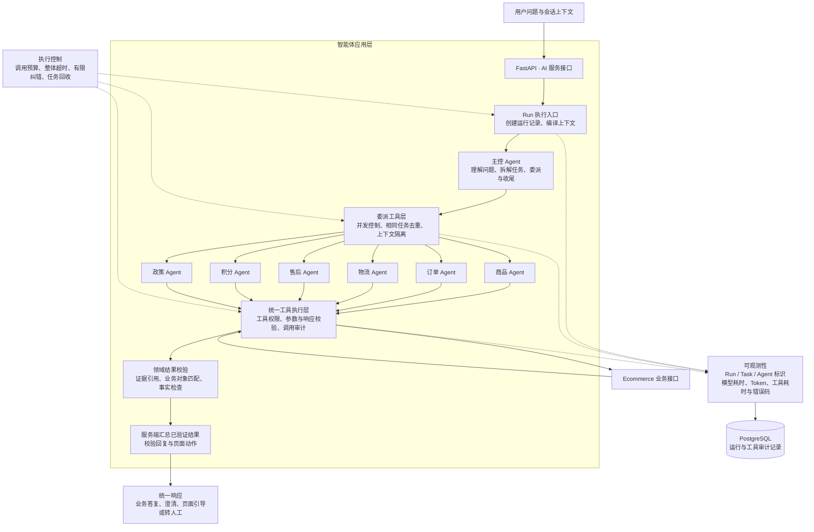

# 积分商城智能客服：智能体应用架构面试介绍

本文根据当前代码整理，聚焦智能体应用开发工程师负责的 AI 服务，不展开 Customer Service 的后端架构。整理日期：2026-10-24。

## 一、面试口述稿

面试官您好，我介绍一下我负责的积分商城智能客服项目，重点讲智能体应用层的架构。

这个项目主要解决商品咨询、订单查询、物流跟踪、售后处理，以及积分余额、兑换资格、积分返还和有效期等问题。我负责的是多智能体编排、业务工具接入、上下文管理、结果校验，以及调用链的耗时和 Token 统计。

**整体采用“主控 Agent＋领域子 Agent＋执行控制层”的架构。** Agent 通过 LangChain 的 `create_agent` 构建，底层使用 LangGraph 的执行机制，FastAPI 提供 AI 服务接口。目前主控和子智能体使用同一款模型，通过不同的提示词、工具权限和任务上下文区分职责。

### 1. 主控与领域专家协作

主控不直接调用业务查询接口，只持有专家委派工具，比如 `consult_order`、`consult_points`。这些工具内部异步调用对应的子智能体，再返回结构化结果，相当于把子智能体包装成主控可以调用的工具。

目前划分了六个领域专家：

| 子智能体 | 主要职责 |
| --- | --- |
| 商品 Agent | 商品信息、库存、积分价格和选品 |
| 订单 Agent | 订单状态、取消及修改地址等页面引导 |
| 物流 Agent | 发货与物流轨迹 |
| 售后 Agent | 退款、退货、换货申请进度 |
| 积分 Agent | 账户余额、流水、到期批次、兑换资格和订单积分返还 |
| 政策 Agent | 查询平台规则和积分制度 |

每个专家只获得自己领域允许使用的工具。领域操作指引由集中配置统一维护，在构建专家时注入，当前采用固定领域配置。

互不依赖的任务支持并行执行，当前默认最多同时运行三个子任务。如果存在依赖，比如先发现商品编号，再校验兑换资格，就需要分两轮执行。每个子任务都有独立的上下文和证据范围，避免不同订单、账户的信息混用。

### 2. 工具与业务数据连接

模型负责理解和决策，余额、订单状态、退款进度等事实通过工具查询业务接口获得。

积分领域目前有四个工具：

| 工具 | 查询内容 |
| --- | --- |
| `get_points_account` | 账户余额、冻结积分和到期概况；需要批次时按需返回 |
| `get_points_transactions` | 积分收支流水 |
| `check_points_eligibility` | 商品兑换资格及不满足条件的原因 |
| `get_order_points` | 订单扣分与积分返还状态 |

所有业务工具都经过统一执行器，检查当前专家是否有调用权限，透传可信身份凭证，校验接口响应，并记录参数、结果、耗时和错误码。用户数据的访问范围还会由业务接口再次校验。

### 3. 结果可信度控制

子智能体返回结构化结果，包括成功、需要澄清、业务失败或服务失败，而不是直接把自由文本发给用户。

涉及业务事实的结论必须引用本次工具调用的证据，并关联具体订单、账户或积分批次。服务端校验证据和业务对象是否匹配；积分数值和返还状态等关键内容，会根据接口字段生成正文。

对外只有一个回复出口，子智能体不直接回复用户。主控负责整体任务收尾，最终业务正文由服务端汇总已经校验的领域结果，减少汇总时再次改写事实的风险。

### 4. 执行稳定性与可观测性

一次请求会创建一个独立的 Run，共享本次请求的执行预算，但不跨用户共享业务状态。执行层限制委派次数、模型调用次数、工具调用次数和整体超时；相同的在途委派会合并等待，请求结束时回收未完成任务。

监控方面，可以按 Run 查看每次模型调用属于主控还是哪个子智能体，以及输入输出 Token、开始结束时间和耗时，也能查看业务工具的调用结果。这让我能判断一次请求慢在哪里，或者为什么出现了不必要的重复委派。

举一个业务例子：用户问“订单取消了，积分还没回来，而且积分明天到期”。主控需要安排订单状态、积分返还和批次有效期等查询；涉及退款申请或需要核查售后处理时，再查询售后申请进度，同时查询有效规则。订单或批次不明确时需要澄清，不能直接承诺延期或补发。

这个项目当前仍在通过场景测试完善路由和必要查询的覆盖。我负责的核心，是把模型的任务决策、可控的工具执行、可信的结果输出和可定位的运行记录连成一条完整链路。

## 二、Mermaid 架构图

下图展示 AI 服务的逻辑关系；执行控制和可观测性是贯穿执行链路的能力。

## 三、结合代码回答追问

| 架构部分 | 主要代码位置 | 可以解释的实现 |
| --- | --- | --- |
| Agent 构建 | `atguigu/agent/factory.py` | 构建主控和六个领域专家，配置模型、工具、结构化输出和预算中间件 |
| 领域注册 | `atguigu/agent/multi_agent/registry.py` | 领域名称、说明和工具范围统一维护 |
| 主控与专家提示词 | `atguigu/agent/harness/dynamic_prompt.py` | 生成主控分工规则和专家领域提示词 |
| 领域操作指引 | `atguigu/agent/harness/skills/catalog.py` | 复用 Skill 配置中的领域指引和工具清单，当前固定注入 |
| 专家委派 | `atguigu/agent/multi_agent/delegation.py` | 将专家封装为工具，异步执行、限制并发、去重并验证结果 |
| 请求执行状态 | `atguigu/agent/multi_agent/state.py` | 每个 Run 独立维护预算、证据、结果和在途任务 |
| 调用预算 | `atguigu/agent/multi_agent/budget.py` | 限制模型、工具和委派调用次数，维护请求执行期限 |
| Run 协调 | `atguigu/agent/harness/run/coordinator.py` | 创建和更新运行记录，映射执行结果与响应事件 |
| 执行与纠错 | `atguigu/agent/harness/run/executor.py` | 编译上下文、控制超时、有限纠错、结果汇总和任务回收 |
| 业务工具执行 | `atguigu/agent/harness/tools/executor.py` | 工具权限、预算、响应校验、调用审计和证据记录 |
| 领域结果校验 | `atguigu/agent/multi_agent/validation.py` | 校验证据引用、业务对象及事实，汇总领域结果 |
| 模型调用指标 | `atguigu/agent/harness/run/metrics.py` | 按智能体记录模型调用耗时、时间区间及 Token 用量 |
| 审计数据模型 | `atguigu/models/models.py` | 保存 Run、工具调用等运行记录 |

### 需要准确区分的概念

- **异步与并行：** 调用使用异步接口；只有互不依赖且主控同时发出的任务才会并行，并受并发上限约束。
- **结构化输出与业务正确性：** 输出符合 Schema 只说明结构合格，还需要校验证据、对象归属和业务字段。
- **主控汇总与最终正文：** 主控负责决策和收尾，当前业务正文由服务端按已验证的专家结果组合，并非完全依赖主控自由改写。
- **Skill 与动态加载：** 当前复用 Skill 配置作为专家固定指引，没有实现按需读取完整 Skill 的渐进式披露。
- **页面引导与业务执行：** Agent 可以提出经校验的页面动作；引导用户进入修改地址等页面，不等于模型直接完成业务修改。
- **运行审计与执行恢复：** 保存 Run 和工具记录不等于已经具备 LangGraph 检查点恢复能力，面试时应以实际实现为准。
- **已实现与待优化：** 现有执行链支持领域委派、并发、预算和证据校验；复杂问题的路由完整性和必要查询覆盖仍需持续用场景测试验证。

## 四、代码的具体位置与阅读入口

下列路径以当前 AI 项目根目录 `ai-service/ai-service` 为基准。前三节是架构介绍；本次整理面试文档没有修改智能体业务代码。

### 1. 多智能体核心代码

| 要找的逻辑 | 具体文件 | 阅读入口 |
| --- | --- | --- |
| 主控和六个子智能体的创建 | [factory.py](../atguigu/agent/factory.py) | `create_support_agent()` |
| 主控如何拆任务、专家遵守什么规则 | [dynamic_prompt.py](../atguigu/agent/harness/dynamic_prompt.py) | `render_supervisor_prompt()`、`render_domain_prompt()` |
| 六个领域的注册 | [registry.py](../atguigu/agent/multi_agent/registry.py) | `DOMAIN_SPECS` |
| 每个领域的工具和操作指引 | [catalog.py](../atguigu/agent/harness/skills/catalog.py) | `SKILL_CATALOG` |
| 子智能体包装为工具、异步委派与并发控制 | [delegation.py](../atguigu/agent/multi_agent/delegation.py) | `DelegationService.tools()`、`delegate()`、`_run_pending()` |
| 每个请求的证据、结果与任务状态 | [state.py](../atguigu/agent/multi_agent/state.py) | `RunExecution` |
| 委派次数、模型次数、工具次数与超时限制 | [budget.py](../atguigu/agent/multi_agent/budget.py) | `RunBudget` |
| 整体执行、有限纠错和最终汇总 | [run/executor.py](../atguigu/agent/harness/run/executor.py) | `AgentExecutor.execute()`、`_execute_with_correction()`、`_compose()` |
| 工具调用的权限、结果校验和审计 | [tools/executor.py](../atguigu/agent/harness/tools/executor.py) | `ToolExecutor.execute()` |
| 专家结果的证据校验与组合 | [validation.py](../atguigu/agent/multi_agent/validation.py) | `validate_domain_output()`、`compose_results()` |
| 模型耗时、所属智能体与 Token 统计 | [metrics.py](../atguigu/agent/harness/run/metrics.py) | `ModelTimingCallback` |
| Run 与工具调用的数据库记录 | [models.py](../atguigu/models/models.py) | `AgentRun`、`AgentToolCall` |

建议先从 `factory.py` 看智能体如何组装，再看 `delegation.py` 的委派过程，最后看两个 `executor.py` 的执行控制与工具调用。

### 2. 最近补充的临期退款场景代码

| 文件 | 实际位置与作用 |
| --- | --- |
| Ecommerce 初始化模块 | [refund_expiry_seed.py](../../../backend/backend/ecommerce-service/ecommerce_service/refund_expiry_seed.py)，对应根目录相对路径 `../../backend/backend/ecommerce-service/ecommerce_service/refund_expiry_seed.py`；`seed_refund_expiry_demo()` 创建独立测试用户、账户、已取消订单、临期批次和演示规则 |
| 隔离测试 | [test_refund_expiry_demo.py](../tests/test_refund_expiry_demo.py)；`RefundExpiryDemoTests` 验证登录与业务查询、跨用户隔离、幂等和编号／项目冲突 |
| 安装时的暂存副本 | [deploy/staging/refund_expiry_seed.py](../deploy/staging/refund_expiry_seed.py)；实际执行入口是上面的 Ecommerce 模块，服务不读取这个暂存副本 |
| 数据初始化核对报告 | [refund-expiry-demo-seed-20261024.json](../reports/refund-expiry-demo-seed-20261024.json) |
| 真实业务接口查询报告 | [refund-expiry-demo-http-20261024.json](../reports/refund-expiry-demo-http-20261024.json) |

初始化模块只在显式运行 `python -m ecommerce_service.refund_expiry_seed` 时执行，不会随服务启动自动插入数据。完整账号和操作说明见[积分客服接入说明](积分客服接入说明.md)。
